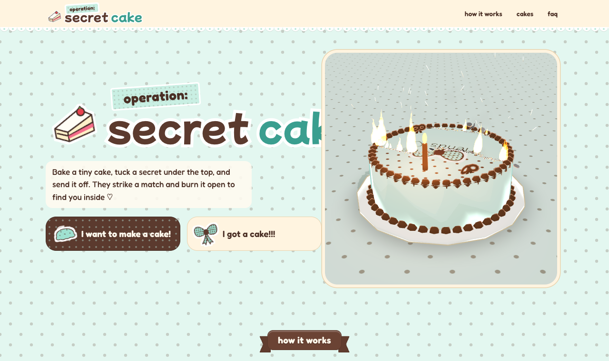
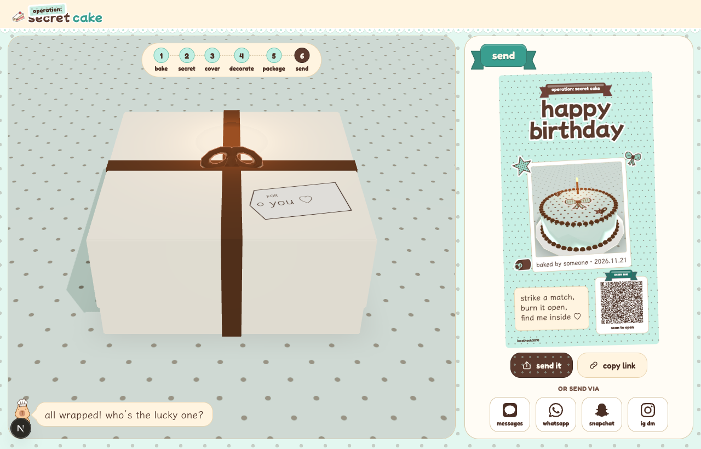
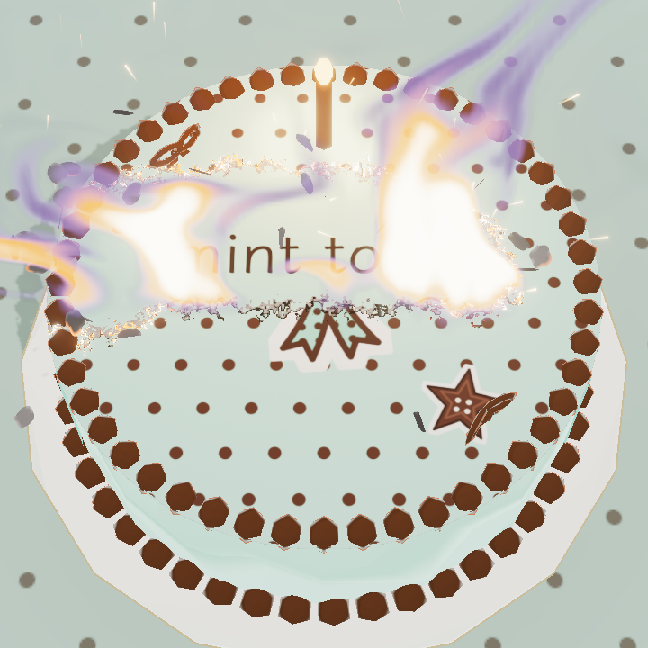
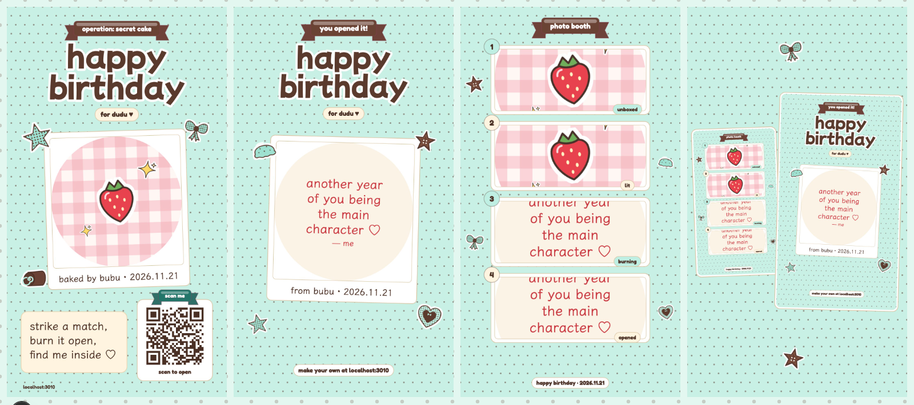
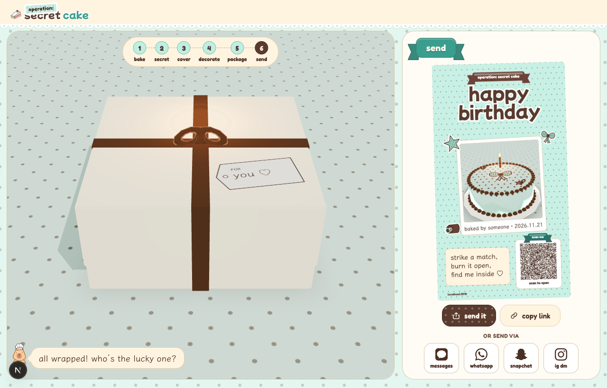

<div align="center">

# operation: secret cake 🎂🔥

**Bake a tiny bento cake. Hide a secret inside. Let them burn it open.**

[**▶ Bake one now**](https://burn-away-bento-cake.vercel.app) · [Send feedback](https://forms.gle/VsL4QpCcDT5QyR8w9) · [Privacy](https://burn-away-bento-cake.vercel.app/privacy)



</div>

---

A little digital gift for the friends you didn’t get a gift for (yet). You decorate a 3D bento cake, write a message under its sugar-sheet top, and send the link. They open the box, strike a match, light the candle, and **burn the top layer away** to read what you wrote. Then they get a photo strip and poster of the moment to post.

No app. No account. No database. The whole cake lives in the link.

## What it’s like

| Make it | Burn it open | Keep it |
|---|---|---|
|  |  |  |
| Six cozy steps with a capy chef guiding you | Real-time paper burn with flames, embers and sound | Story-sized poster + photo strip to share |

### For the person sending
1. **Bake**: pick a shape (round, heart, square), frosting and piping.
2. **Secret**: write your message, choose the lettering, ink, a sticker and a signature.
3. **Cover**: the sugar sheet on top that burns away. Use art, your own photo, or piped words, then stamp stickers anywhere on it.
4. **Decorate**: bows, cherries, strawberries, pearls, sprinkles and a candle.
5. **Package**: names, box and ribbon. Optional **unlock time** (a countdown until then) and **passcode** (numbers only, with your own question).
6. **Send**: share the link, send it straight to Messages / WhatsApp / Snapchat / IG, or save the poster with its QR code. You can preview it exactly as they’ll see it first.



### For the person receiving
Open the link → (countdown) → (passcode) → tap the box → swipe a match → light the candle → hold the flame on the cake → watch it burn → read the secret → save or share the **photo strip** and **poster**, or **bake one back**.

## How it works

**The cake is the link.**
- `?d=` holds the design, compressed with lz-string. The server reads it to draw the link preview card (a closed box, never the secret).
- `#…` holds the secret. Browsers never send the part after `#` to a server, so the message never reaches us.
- With a passcode, the secret is encrypted on the sender’s device (AES-GCM, key from PBKDF2) before it goes into the link.
- Photos are resized in the browser and stored in Vercel Blob so the link can show them.
- A burnt cake stays burnt on that device (localStorage). Anyone else with the link gets their own burn, so a whole group chat can open the same cake.

Because everything is in the link, **old links keep working after new deploys**. A deploy changes how cakes are drawn, not what’s in them.

| Route | What it is |
|---|---|
| `/` | landing page with a live burning demo and premade cakes to burn or customize |
| `/bake` | the six-step maker |
| `/c?d=…#…` | opening a cake |
| `/api/og` | per-link preview image (iMessage, Discord, etc.) |
| `/api/upload` | short-lived upload tokens for Vercel Blob |
| `/api/subscribe` | optional “tell me when new cakes drop” mailing list (Resend) |
| `/privacy`, `/credits` | privacy policy and assets used |

## Tech

- **Next.js** (App Router) + TypeScript
- **three.js** via **React Three Fiber** + drei: low-poly cake with a custom toon shader (soft bands, tinted shadows, rim light) and tone-matched outlines
- **[Paperlab](https://github.com/NourMtir0722/Paperlab)** for the burn: paper damage simulation, fluid flames, embers, ash and synthesized fire sound
- **capy-ui** for the capybara chef and a few controls
- Canvas-drawn keepsakes (posters, photo strip, QR) and a Web Share sheet for posting
- Vercel hosting, Vercel Blob for photos, Resend for the optional mailing list

### Performance
The 3D adapts to the device: pixel ratio is capped and lowered automatically on slow machines, shadows and bloom turn off when frames drop, the heavy fluid fire falls back to lighter flames mid-burn if needed, phones get a lighter landing demo, and canvases stop rendering when scrolled out of view.

**Render tiers.** Each browser remembers how much 3D it can take: `full` (desktop), `lite` (phones: no shadow maps or bloom, pixel ratio 1), and `flat` (no WebGL: 2D cake previews and a 2D canvas burn). If the GPU drops the WebGL context (Chrome’s sad-face canvas) or the scene errors, the page steps down a tier and redraws, so a cake can always be opened. Force a tier with `?render=full|lite|flat` for testing.

## Run it locally

```bash
git clone https://github.com/blu-octopus/burn-away-bento-cake.git
cd burn-away-bento-cake
npm install
npm run dev          # http://localhost:3000
```

Optional environment variables (`.env.local`; see `.env.example`):

| Variable | What it enables | Without it |
|---|---|---|
| `BLOB_READ_WRITE_TOKEN` | photo uploads to Vercel Blob (created automatically when you add a Blob store to the Vercel project) | photos are shrunk and stored inside the link, so links get long |
| `RESEND_API_KEY`, `RESEND_AUDIENCE_ID`, `NEXT_PUBLIC_MAILING_LIST=1` | the “tell me when new cakes drop” opt-in, saved to a Resend Audience | the opt-in box is hidden; receipts still work (they open the sender’s own mail app) |
| `NEXT_PUBLIC_SITE_URL` | the public URL used in links and QR codes | uses the current site’s address |

Dev-only pages (404 in production): `/dev/burn` (burn test bench), `/dev/kit` (UI kit), `/dev/posters` (keepsake previews).

## Make it yours

- **Words**: every line of copy lives in [`src/content/copy.ts`](src/content/copy.ts). Edit a string and the page updates.
- **Premade cakes**: [`src/lib/gallery.ts`](src/lib/gallery.ts)
- **Stickers and cover art**: [`src/lib/art.ts`](src/lib/art.ts) (hand-drawn SVGs)
- **Colors and theme**: CSS variables at the top of [`src/app/globals.css`](src/app/globals.css)
- **Burn feel**: speed and look in [`src/components/three/BurnSheet.tsx`](src/components/three/BurnSheet.tsx)

```
src/
  app/            pages: landing, /bake, /c (open a cake), /privacy, /credits, api routes
  components/
    maker/        the six-step cake maker
    three/        cake, box, stage, toon shader, burn sheet, sparkles
    ui/           logo, capy chef, ribbons, icons, number pad
  content/copy.ts every word on the site
  lib/            design model, link encoding + encryption, art, textures, posters
  capy/           vendored capy-ui
```

## Feedback

Found a bug or have an idea? **[Tell me here](https://forms.gle/VsL4QpCcDT5QyR8w9)** or [open an issue](https://github.com/blu-octopus/burn-away-bento-cake/issues).

## Credits

Made by [blu-octopus](https://github.com/blu-octopus).

- Burn effect: **Paperlab** © Nour Mtir, Apache-2.0 (see [`NOTICE`](NOTICE))
- UI and the capy mascot: [capy-ui](https://github.com/blu-octopus/capy-ui) (MIT), vendored in `src/capy`
- Brand icons: [simple-icons](https://simpleicons.org) (CC0)
- Fonts: Mochiy Pop One, Fredoka, Klee One and friends via Google Fonts (OFL)
- Sticker style inspired by [salt-journal-materials](https://github.com/carolinaaafy/salt-journal-materials); all stickers here are original

The full list is on the [assets used](https://burn-away-bento-cake.vercel.app/credits) page.

## License

Code is [MIT](LICENSE). Paperlab is used under Apache-2.0 (see [`NOTICE`](NOTICE)).
